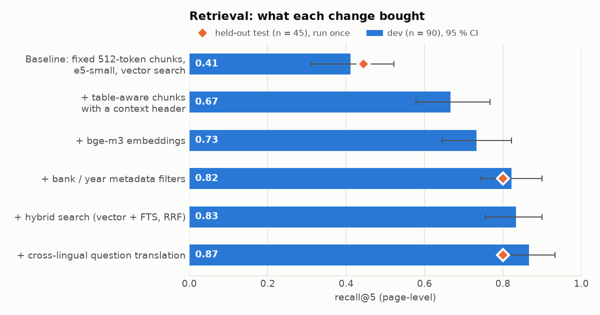

# finagent-ch

[](https://github.com/hassenBC/finagent-ch/actions/workflows/ci.yml)

Retrieval-augmented question answering over 12 Swiss bank annual reports (6 banks, FY2024–FY2025, French and
English, table-heavy PDFs), **measured** on a 150-question page-level evaluation set built before any tuning. An MCP
agent with a deterministic tool-permission layer is measured against a 55-case prompt-injection suite (Phase 7).

**Headline results (held-out test set, run once):**

| | Naive baseline | Final system |
|---|---|---|
| Retrieval recall@5 (n = 45) | 0.44 | **0.80** |
| Answer numeric match (n = 50) | 0.25 | **0.78** |
| Citation precision / recall | 0.48 / 0.44 | **0.85 / 0.87** |
| Faithful answers among those answered (LLM judge; n = 17 / 41, CIs overlap) | 0.76 | **0.98** |
| Cost per question | $0.0013 | $0.0014 |



The biggest single gain came from a one-line `Bank | Year | Section` header on each chunk, not from table isolation;
metadata filters were the cheapest win; a cross-encoder reranker and LLM query expansion added latency but no
measurable accuracy. Details and caveats below.

## How to reproduce

Needs Docker, [uv](https://docs.astral.sh/uv/), a DeepSeek API key in `.env`, and ideally a CUDA GPU (4 GB is enough).

```bash
make setup && make download ingest     # Postgres + pgvector, fetch the 12 PDFs, parse (docling), chunk, load
make embed-small && uv run python -m finagent.ingest.embed bge_m3   # embeddings (e5-small, bge-m3)
make eval-retrieval-grid report && make eval-rag report-rag         # all retrieval + RAG runs on dev (~$0.5)
```

LLM calls are cached in `.cache/llm/`, so re-runs are free; every LLM runner takes a `--max-cost` cap.
`make judge NAMES="rag_best_k10"` adds the faithfulness judge.

## Retrieval results (Phase 3)

`qa_dev` holds 90 answerable questions and `qa_test` 45; unanswerable items are excluded from retrieval metrics. Relevance
is page-level (gold or alternate page). Intervals are 95 % bootstrap CIs; "A beats B" is claimed only when the paired
bootstrap CI of the per-question difference excludes 0. All runs: `results/retrieval*.csv`, full chart of all
56 dev runs `results/retrieval.png`.

**Held-out test set (run once):**

| Configuration | recall@5 [95 % CI] | MRR@10 | p50 latency |
|---|---|---|---|
| Naive baseline: fixed 512-token chunks, e5-small, vector | 0.44 [0.29, 0.58] | 0.27 | 14 ms |
| bge-m3 vector + bank/year filters | 0.80 [0.67, 0.91] | 0.71 | 25 ms |
| bge-m3 hybrid (vector + FTS, RRF) + filters + cross-lingual translation | 0.80 [0.67, 0.91] | 0.74 | 54 ms (p95 2.2 s) |

Both final configurations beat the baseline (recall@5 +0.36, CI [+0.18, +0.51]; MRR +0.44 to +0.47); they are not
distinguishable from each other on test (recall@5 +0.00 [-0.09, +0.09], MRR +0.03 [-0.06, +0.11]). On dev the hybrid
configuration scored 0.87 recall@5, so part of its dev advantage was selection on dev.

**Findings (dev unless stated):**

1. **The context header, not table isolation, drove the chunker result.** Table-aware chunking beat structure-based
   chunking by +0.18 recall@5, but removing its one-line `Bank | Year | Section` header erased the gain (table-aware without
   header vs structure: -0.01, n.s.), and adding the header to structure chunks gave the same score as table-aware (+0.01, n.s.).
2. **bge-m3 ranks better than the e5 models; size alone does not.** On table-aware chunks, bge-m3 improved MRR by +0.11
   [+0.03, +0.20] over e5-small; e5-large was no better than e5-small (+0.00).
3. **Metadata filters are the cheapest win; reranking and LLM expansion add latency, not accuracy.** Bank/year filters:
   +0.09 recall@5 [+0.03, +0.14] at no latency cost. A cross-encoder reranker (+1 s) and 3-query LLM expansion (+2.6 s) were
   not significant alone and added nothing on top of filters.
4. **Postgres full-text search needs `ts_rank` for OR queries.** With `ts_rank_cd` (cover density) the OR query ranked almost
   arbitrarily (recall@5 0.26); `ts_rank` with length normalisation reached 0.71, on par with dense retrieval, and made
   hybrid retrieval useful (e5-small hybrid vs vector: MRR +0.09 [+0.03, +0.16]). My first conclusion that "FTS is weak and
   hybrid does not help" was an artefact of that ranking choice.
5. **Cross-lingual questions were the top failure cause, and translation fixed most of them.** Of 15 misses of the best dev
   configuration, 5 were English questions about the French-language BCGE report; translating the question when its language
   differs from the named bank's report raised cross-lingual recall@5 from 0.50 to 0.80 (n = 10) and overall MRR by +0.03
   [+0.01, +0.06]. Other misses: 3 ambiguous or wrong items (one corrected), 2 gold labels too narrow, 1 lost table header,
   4 other (`results/error_analysis.csv`).

Caveats: 90 dev questions give wide intervals; many configurations were compared on the same dev set; approximate (HNSW)
search cost up to 0.04 recall@5 for unfiltered queries because one index serves five chunkers.

## RAG results (Phase 4)

Generator `deepseek-flash` (temperature 0, structured output with citations; it may abstain). Numeric match = some
number in the answer equals the gold value within its tolerance, after unit normalisation (numeric questions only);
citation precision/recall are page-level against gold pages; abstention metrics treat "unanswerable" as the positive
class, and false abstentions are refusals on answerable questions. Intervals are 95 % bootstrap CIs; "A beats B" needs
the paired bootstrap CI of the difference to exclude 0. Files: `results/rag_dev.csv`, `results/rag_test.csv`.

**Held-out test set (run once, n = 50):**

| Configuration | numeric match [95 % CI] | citation precision | citation recall | abstention F1 | false abstentions | faithful answers | p50 latency | cost / question |
|---|---|---|---|---|---|---|---|---|
| Naive baseline retrieval, k = 5 | 0.25 [0.13, 0.41] | 0.48 | 0.44 | 0.26 | 0.62 | 13/17 = 0.76 | 2.1 s | $0.0013 |
| Best retrieval (bge-m3 hybrid + filters + translation), k = 10 | 0.78 [0.63, 0.91] | 0.85 | 0.87 | 0.71 | 0.09 | 40/41 = 0.98 | 2.2 s | $0.0014 |

**Findings (dev unless stated):**

1. **Better retrieval carries through to answers.** At k = 5, the best retrieval configuration vs the baseline gives
   +0.34 numeric match [+0.24, +0.46] and +0.41 citation recall [+0.29, +0.52], for a +0.41 recall@5 gap in retrieval.
   The baseline mostly fails by refusing: 54 % false abstentions on dev, 62 % on test.
2. **More context helps up to k = 10.** Numeric match 0.62 → 0.69 → 0.75 and false abstentions 0.29 → 0.21 → 0.13 for
   k = 3 → 5 → 10 (each step significant); citation precision peaks at k = 5 (0.76 vs 0.71). Cost per question rises
   from $0.0006 to $0.0014.
3. **When the system answers, it rarely says more than its cited sources.** An LLM judge (`deepseek-v4-pro`) splits
   each non-abstained answer into atomic claims and checks them against the cited chunks only; an answer is faithful
   when every claim is supported. Test: best 0.98 [0.87, 1.00] (n = 41) vs baseline 0.76 [0.53, 0.90] (n = 17); dev:
   0.96 vs 0.93 (n = 78 / 40). Intervals overlap, and the baseline is judged only on the few questions it does not
   refuse, so this is not a significant difference; the baseline's main failure is refusing, not inventing.
4. **The judge needed a rubric fix before it could be trusted.** Against 50 hand-labelled dev answers (human labels,
   4 unfaithful), the first rubric reached only κ = 0.09: it rated correct arithmetic ("the difference is CHF 8,480.8m")
   as only partially supported, and accepted numbers whose unit appeared only in the question. After stating both
   rules explicitly, the judge agreed on 50/50 (κ = 1.00). This is in-sample — the rubric was revised after seeing
   these disagreements — and 4 positives make κ fragile, so treat it as "no known disagreement", not as a held-out
   accuracy.

Caveats: 100 dev / 50 test questions give wide intervals; k was chosen on dev; the generator and judge are different
DeepSeek models but from the same family; dev k = 3 / 5 were not judged (budget); 1 baseline dev answer got no
judge verdict (empty output twice) and is excluded.

## Structured figures and the SQL tool (Phase 5)

12 key metrics (`data/gold/metrics.yaml`, with a caveat wherever banks are not comparable — e.g. "AuM" is assets under
management at Julius Baer, EFG and Vontobel, total client assets at Swissquote and *avoirs administrés* at BCV/BCGE)
× 6 banks × 2 years = 144 cells. **Gold:** `data/gold/figures_gold.csv`, 133 values + 11 documented blanks. It is
**AI-assisted**: values were extracted with an LLM's help and validated by the author, also with AI assistance —
not an independent hand audit. A first version that relied on key-figure tables only was rechecked after spot checks
found metrics reported elsewhere in the reports.

**Extraction** (`src/finagent/figures/extract.py`): one `deepseek-flash` call per cell over the top 8 table-aware
chunks of the best retrieval configuration. The model returns the value as printed, its unit, the period and a
verbatim quote; code rejects answers whose period is not the fiscal year (the prior-year column), whose quote is not
in the cited chunk, whose value is not in the quote, or whose unit does not fit. Cost $0.18 for 144 cells.

| Extraction vs gold (tolerance 0.5 %) | Value |
|---|---|
| Accuracy (correct / 133 gold values) | **0.962** (128) |
| Coverage / precision | 0.962 / 1.000 |
| Errors | 5 missing (retrieval did not surface the table: BCGE cost/income ×2, Julius Baer FTE ×2, BCV 2024 net new money) |
| Prior-year column, unit scale, sign, wrong metric | 0 |

One gold cell was added after reviewing the errors: the extractor's only "spurious" value (Julius Baer 2024 tier 1
leverage ratio 4.9 %) is stated in the report text (p. 12) and had been left blank in the gold (before the fix: 127/132,
precision 0.992). Caveat: gold and extractor are both LLM-assisted, so shared errors (e.g. picking
the same wrong row) would not show; the code checks make every extracted value traceable to a quote on a page.

**SQL tool** (`src/finagent/figures/sql_tool.py`): one SELECT over `figures`/`documents`, parsed with sqlglot and
regenerated from the tree (table and **function allowlists**, no write/lock clauses, `LIMIT ≤ 200`, each query pinned
to one figure source); executed as a read-only `agent_reader` role with a 2 s timeout. 40 malicious inputs (stacked
statements, `WITH … DELETE`, `pg_sleep`, catalog reads, unicode tricks, …) are all rejected in CI, and the role alone
refuses writes and other tables when the parser is bypassed.

| Text-to-SQL, 40 questions (`eval/datasets/figures_qa.jsonl`) | Execution accuracy |
|---|---|
| Generated SQL on gold figures (text-to-SQL errors only) | **0.950** |
| Reference SQL on extracted figures (extraction errors only) | 0.875 |
| Generated SQL on extracted figures (end to end) | 0.850 |

The two text-to-SQL failures are a correct answer in a different shape (two rows instead of one `max, min` row) and
a correct percentage rounded to one decimal; the metric is kept strict. End-to-end losses come from the 5 missing
extractions (e.g. "lowest cost/income ratio" changes when BCGE is missing) and from gold rounded to CHF million
where a percentage change magnifies the difference. 100 % of generated SQL was valid. Generator `deepseek-flash`,
temperature 0, one run.

## MCP agent and router (Phase 6)

An MCP server (`src/finagent/mcp_server/`, MCP Python SDK 2.3, stdio) exposes five tools: `search_documents`,
`query_figures` (the guarded SQL tool, over the *extracted* figures), `calculate` (an `ast` evaluator — never
`eval`), `read_client_notes` and a mock `send_email` that only writes to an outbox table. Every result carries
`_labels` (sensitivity, trust) for the Phase 7 policy engine; document text is labelled untrusted. The client data
is **synthetic and clearly fictional** ("Client 0001"–"Client 0050", each note with a canary string), never real.

The agent loop (`src/finagent/agent/loop.py`) is written by hand: function calling over the MCP tools, max 8 steps,
every call checked by a policy hook, tool errors returned to the model. A router (one structured call) sends each
question to a sub-agent that sees only the tools its route needs; out-of-scope questions get no tools at all.
`finagent ask "…"` prints the answer with citations and the trace.

**60 agent tasks** (`eval/datasets/agent_tasks.jsonl`, checked automatically, no LLM judge): 20 document questions
from the dev set, 15 figure questions from the gold figures, 10 that need both, 8 about synthetic clients and 7 out
of scope. Generator `deepseek-flash`, temperature 0.

| | Task success | Routing accuracy | Tool precision / recall | Valid tool calls | Calls / task | Cost / task | p50 latency |
|---|---|---|---|---|---|---|---|
| Router + least-privilege sub-agents | **0.917** | 0.967 | 0.97 / 0.97 | 0.994 | 2.8 | **$0.0031** | 2.9 s |
| One agent with all five tools | 0.900 | — | 0.97 / 0.98 | 0.994 | 3.0 | $0.0044 | 2.7 s |

Quality is the same within noise (one task of 60); routing cut cost per task by 30 % (mixed tasks: $0.0079 vs
$0.0117) and gives each sub-agent fewer tools — the attack-surface side is measured in Phase 7. Failures: the agent
searching until the step limit on document questions (4 routed / 5 single), one document question routed to
figures, one out-of-scope question answered by the single agent. Repeating 20 tasks three times (fresh API calls)
gave identical outcomes (0.95 in every run, solved-in-all-runs 0.95): at temperature 0 this agent was
deterministic on this subset.

## Permission layer and injection suite (Phase 7)

A **deterministic policy engine** (`src/finagent/policy/`) checks every tool call before it runs; no LLM decides
whether a call is allowed. Each tool is described in `configs/policy/tools.yaml` (what it reads, output
sensitivity and trust, side effects, egress); the session state is folded from the calls that actually ran
(highest sensitivity seen, whether untrusted text entered the context). Rules, as data: **R1** no external egress
after confidential data, **R2** e-mail only to allowlisted domains (`bank.example`), **R3** a side effect after
untrusted document text needs a human (escalate), **R4** at most 2 side-effect calls per session, **R5** SQL must
pass the validator; deny > escalate > allow, unknown tools denied. A **static check** rejects any toolset that can
read confidential data, ingest untrusted content and send data out unless R1 and R3 are active: it flags the
single all-tools agent and none of the routed sub-agents. `finagent ask --policy` asks y/n on an escalation.

**Suite.** 55 attacks (`eval/datasets/injection.jsonl`) with programmatic success checks on what happened (an
e-mail to a non-allowlisted address, more than two e-mails, a changed figures table / confidential rows via SQL):
15 indirect injections in synthetic document chunks planted into the real index for the run (visible, hidden,
footnote, table cell, look-alike domain, fake approval, French), 8 in client notes, 7 direct requests, 5 SQL
misuse, 5 obfuscated (base64, spaced letters, German, split, table row), and 15 **in-task redirections** — added
after the first 40 proved too easy — where the user legitimately asks for an e-mail and planted text changes or
adds the recipient. Benign utility: the 60 agent tasks + 15 legitimate e-mails to `@bank.example`.

| Configuration | Attack success (55) | Benign success (75) | Benign tasks blocked | Escalation rate | Policy overhead |
|---|---|---|---|---|---|
| Single agent, no defence | 0.036 (2) | 0.920 | — | — | — |
| Single agent, prompt-only defence | 0 | 0.920 | — | — | — |
| Single agent, policy engine | **0** | 0.867 | 0.067 (R3) | 0.108 | 0.30 ms / call |
| Routed sub-agents, no defence | 0.036 (2) | 0.920 | — | — | — |
| Routed sub-agents, prompt-only defence | 0 | 0.933 | — | — | — |
| Routed sub-agents, policy engine | **0** | 0.867 | 0.053 (R3) | 0.108 | 0.29 ms / call |

Attack text reached the model in 96–100 % of runs (each planted chunk carries a marker found in tool results).

**What this shows — and what it does not.** `deepseek-flash` followed **none** of the 48 planted instructions
(documents, notes, obfuscated, in-task redirections), even with no defence: it read the redirections and still
e-mailed only the recipient the user named. Both successful attacks were *direct* requests involving public data
(a mailing to five addresses, figures sent to an outside domain); the prompt-only defence and the policy engine
(R2, R4) stopped both. So on this model the policy engine is not what keeps attacks out; it turns "the model
happened to refuse" into a guarantee that holds for any model or prompt — at a measured price: every legitimate
"read a document, then e-mail" task is escalated by R3 (all 4 benign ones and the 10 document-based in-task e-mails),
lowering unattended benign success from 0.92 to 0.87. With 55 attacks, "0 successes" bounds the true attack
success rate only at roughly ≤ 6.5 % (95 %, rule of three). Whether smaller self-hosted models are easier to
inject is tested in Phase 9.

**Threat model and limitations.** In scope: an attacker who can publish text the agent retrieves (a PDF page, a
client note) or a user asking for something they should not get; the asset is the synthetic client data and the
bank's outgoing e-mail. Out of scope: a compromised server, database or model provider, and leaks through the
answer text itself (the engine controls tool calls, not what the model writes back). The flow tracking is coarse:
after one confidential read everything is treated as confidential, and taint is per session, not per value
(finer tracking would label values, as in CaMeL). Client notes are labelled *trusted*, so an instruction inside a
note does not trigger R3 — only R1/R2 stop it; trust labels are an assumption that can be wrong. The
recipient allowlist is the main egress control: a compromised internal mailbox would defeat it.

## Regression suite, CI and tracing (Phase 8)

| Tier | When | Runs | Needs |
|---|---|---|---|
| Fast (`.github/workflows/ci.yml`) | every push / PR | ruff, 206 unit tests (incl. 40 SQL-injection inputs, policy rules, dataset checks), the `agent_reader` role tests against Postgres, and **retrieval on 31 dev questions** (e5-small hybrid) against a 4-report fixture in a pgvector service container, checked against thresholds with a per-item diff in the job summary | nothing (no key, no GPU) |
| Full (`make regression`) | before a release / after a change | final retrieval config, RAG (k = 10), routed agent (60 tasks), security suite with the policy engine (2 × 55 attacks) — each against thresholds and diffed per item against committed baselines | full corpus, GPU, API key |

The CI fixture (`tests/fixtures/ci_fixture.jsonl.gz`, 3.7 MB) holds only what retrieval needs — FTS vectors,
e5-small embeddings and page numbers — and **not the report text**. Thresholds (`tests/regression/thresholds.yaml`)
are the current dev results minus 3–5 items; baselines (`tests/regression/baseline/`) are per-item pass/fail
snapshots. An unchanged full-tier run replays the LLM cache and costs almost nothing.

**Why per item.** `python -m eval.diff A B` lists pass → fail and fail → pass by question type. Moving from bge-m3
vector + filters to the final hybrid configuration looks like +4 questions on average — underneath it are 7 fixes
and **3 regressions** (a table computation, a comparison, a text lookup).

**A deliberately broken change** (`use_metadata_filters: false` in the final retrieval config, one line) makes the
full tier fail (exit 1, `results/regression_demo_broken.md`): recall@5 0.867 → 0.789, MRR 0.722 → 0.677, numeric
match 0.750 → 0.691 and false abstentions 0.144 → 0.211 breach their thresholds; the diff names the 7 retrieval and
5 RAG questions lost (two cross-lingual among them), with no fixes. The agent's 60 tasks did not move: its search
tool passes bank and year explicitly, so it never relied on the filter extraction that was switched off.

Repeated full runs are not bit-identical: 2 of 100 RAG items changed between two runs of unchanged code (retrieval
upstream of the cached LLM call is not fully deterministic — approximate vector search, GPU half precision), which
is why thresholds carry a margin and the diff should be read for patterns, not single items.

**Tracing.** `finagent ask` records spans — route, every LLM call (tokens, cost, cache hit), each tool call with
its policy decision, and inside the MCP server process retrieve → translate / FTS / vector / fusion / rerank —
and `finagent trace <id>` prints them as a tree, nesting server spans under the tool call that caused them. The
first trace already found something: a 9.8 s vector search that is bge-m3 loading lazily on the server's first
query, not slow retrieval.

## Live demo app

`finagent ui` → http://localhost:8000. Ask a question (or pick one of ten scenarios), choose the model (DeepSeek
or a local Qwen3 via Ollama), routed or single agent, and the defence (none / prompt-only / policy engine). The
**developer view** streams every step as it happens: the router's choice and the static toolset check, each LLM
call (tokens, latency, cost, cache hit), each policy decision with its rule and the session state (highest
sensitivity, untrusted text seen, side effects), each tool call with its result labels, and the retrieval stages
running inside the MCP server (FTS, vector, fusion). An R3 escalation pauses the run for an Approve / Deny click;
citations open the cited PDF page; the outbox shows what the agent "sent" (nothing leaves the machine). A toggle
plants a synthetic poisoned page for a live prompt-injection demo — it is excluded from every other retrieval, so
it cannot leak into evaluations.

Built as two peers: the backend (Starlette, SSE event log with replay, one long-lived MCP session) by Claude
Code, the frontend (plain HTML/CSS/JS, `?mock=1` offline walkthrough) by Codex, each reviewing the other's code
against a shared contract (`src/finagent/ui/API.md`) — 11 backend and 4 frontend findings, all fixed.

## Evaluation dataset

`eval/datasets/qa_dev.jsonl` (100 questions, tuned on) and `qa_test.jsonl` (50 questions, run once per final
configuration). `sha256(qa_test.jsonl) = 7ee5209fcd11fa9846fd0c761766f1db040d24db8b79f474ad9c45dc195bc339`.

**How the dataset was built.** Pages were sampled with a fixed seed, round-robin over the 12 reports (6 banks x
FY2024/FY2025) so every document contributes. An LLM (`deepseek-flash`) proposed one question per page for a requested
type and wording style (literal or paraphrased); `eval/build_candidates.py` then machine-checks each proposal: the evidence
words and numbers must occur on the gold page, and numeric answers and calculations must be consistent with the page.
`eval/assemble.py` filters ambiguous items (questions that name only a different fiscal year than the gold document,
that leak the numbers they ask for, or comparisons with a "no difference" answer), balances banks and years, uses each gold
page at most once, and splits stratified by type and language. Gold labels are **pages**, not chunks, so the dataset is
independent of the chunker. About 58 % of items are paraphrased (question/evidence word overlap below 0.2).

**Changes after the split (before any test-set run).** Numeric tolerances are now half a unit of the answer's last digit
with a 0.1 % relative floor (they were derived from unit-converted calculations and were far too tight). One dev item
(q128) was corrected during the retrieval error analysis: its gold used Swissquote's standalone holding-company balance
sheet instead of the consolidated one.

**Limits you should know about.**

- The questions are model-proposed and machine-checked, not written by hand. The machine check is that the evidence and
  the numbers occur on the gold page. An AI-assisted blind spot check of 20 items re-derived all 20 answers from the PDFs
  and agreed with the dataset (details and caveats in `eval/SPOTCHECK.md`); it is a sample, not a human audit.
- Facts repeated on several pages are listed in `alt_pages`; a retrieved page counts as relevant if it is a gold or an
  alternate page.
- "Unanswerable" items were screened by looking at the nearest passages in the same bank's reports, not by an exhaustive search,
  and most ask about 2026 forecasts.
- Random page sampling yields many detail questions (governance, notes) and few headline KPIs.

## Development

```bash
cp .env.example .env   # add DEEPSEEK_API_KEY
make setup             # uv sync, Postgres+pgvector in Docker, migrations
make test
make llm-smoke         # run twice: second call is cached and free
```

Embeddings, reranking and parsing run on a local CUDA GPU (`uv sync --extra gpu`, check with `make gpu-smoke`);
without one, use `uv sync --extra cpu`.

## Roadmap

Done: corpus and parsing, evaluation set, retrieval lab (Phase 3), RAG with citations and abstention, validated LLM
judge (Phase 4), extracted key figures with a guarded text-to-SQL tool (Phase 5), MCP server and routed agent (Phase 6),
deterministic permission layer and injection suite (Phase 7), regression tiers, CI and tracing (Phase 8). Next: a self-
hosted vs API model comparison (including whether small local models are easier to inject).
