# finagent-ch

**A measured, permission-aware LLM agent over Swiss bank annual reports.**

[](https://github.com/hassenBC/finagent-ch/actions/workflows/ci.yml)


Question answering over 12 annual reports (6 banks, FY2024–FY2025, French and English, table-heavy PDFs), **measured** on a
150-question page-level evaluation set built before any tuning. An MCP agent with a deterministic tool-permission layer is
tested against prompt-injection suites.

[Demo](#demo) · [Results](#results-at-a-glance) · [Architecture](#architecture) · [Quickstart](#quickstart) · [Report and paper](#report-and-paper) · [License](#license)

## Demo

[](docs/demo/demo.mp4)

*77 s, real runs (click for the MP4). Re-record with `make demo`; the scripts are in [`docs/demo/`](docs/demo/).*

| You can | How |
|---|---|
| **Ask in French or English** | Answers are built from a SQL lookup plus a calculator; every figure links to the exact report page. |
| **See every agent step** | Search stages, tool calls, cost, and which text is untrusted, live in the developer view. |
| **Stay in control** | After reading untrusted text, a side effect such as an e-mail waits for a human to approve. |
| **Block data leaks** | A deterministic policy engine denies an e-mail to an outside address and names the rule. |
| **Check the numbers** | The results below come from a held-out test set, not from the demo. |

## Headline results

Held-out test set, each configuration run once. Internal benchmark on a small corpus: questions are model-proposed and machine-checked, figure gold values are AI-assisted and author-reviewed, and the faithfulness judge was calibrated on 50 dev answers (4 unfaithful); none has an independent human audit.

| | Naive baseline | Final system |
|---|---|---|
| Retrieval recall@5 (n = 45) | 0.44 | **0.80** |
| Numeric match, any answer number (n = 32 numeric questions) | 8/32 = 0.25 | **25/32 = 0.78** |
| Citation precision / recall | 0.48 / 0.44 | **0.85 / 0.87** |
| Faithful answers among those answered (LLM judge; n = 17 / 41, CIs overlap) | 0.76 | **0.98** |
| Cost per question | $0.0013 | $0.0014 |


The biggest single gain came from a one-line `Bank | Year | Section` header on each chunk, not from table isolation;
metadata filters were the cheapest win; a cross-encoder reranker and LLM query expansion added latency but no measurable
accuracy.

## Architecture

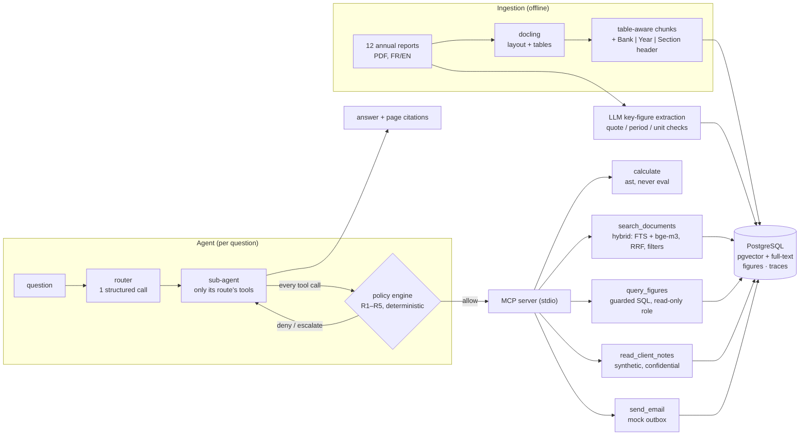

Every tool result carries labels (sensitivity, trust) that the policy engine folds into the session state; every step is
traced (`finagent trace <id>`) and streamed to the demo app's developer view.

## Quickstart

Needs Docker, [uv](https://docs.astral.sh/uv/), a DeepSeek API key in `.env`, and ideally a CUDA GPU (4 GB is enough). `make setup` installs the GPU extra; on a CPU-only machine use `uv sync --extra cpu` instead. Running the project requires permission under the [license](#license).

```bash
cp .env.example .env   # add DEEPSEEK_API_KEY
make setup             # uv sync --extra gpu, Postgres + pgvector in Docker, migrations
make test
make download ingest   # fetch the 12 PDFs, parse (docling), chunk, load
```

<details>
<summary>Run the development retrieval and RAG evaluations</summary>

```bash
make embed-small && uv run python -m finagent.ingest.embed bge_m3   # embeddings (e5-small, bge-m3)
make eval-retrieval-grid report && make eval-rag report-rag         # all retrieval + RAG runs on dev (~$0.5)
make judge NAMES="rag_best_k10"                                     # faithfulness judge
```

LLM calls are cached in `.cache/llm/`, so re-running an unchanged step is nearly free; every LLM runner takes a `--max-cost` cap. Embeddings,
reranking and parsing run on a local CUDA GPU (`uv sync --extra gpu`, check with `make gpu-smoke`); without one use
`uv sync --extra cpu`. Run `make llm-smoke` twice to see the cache: the second call is free.

</details>

## Results at a glance

| Area | What was measured | Result | Details |
|---|---|---|---|
| Retrieval | recall@5, 45 answerable test questions | 0.44 → **0.80** | [below](#retrieval) |
| RAG answers | numeric match, 32 numeric test questions | 0.25 → **0.78** | [below](#rag-answers) |
| Key figures | extraction vs 133 gold values | **96.2 %** accuracy, precision 1.00 | [below](#key-figures-and-the-sql-tool) |
| Text-to-SQL | 40 questions, end to end | **0.85** (0.95 on gold figures) | [below](#key-figures-and-the-sql-tool) |
| Agent | 60 tasks, router + sub-agents | **0.92** success, 30 % cheaper than one agent | [below](#agent-and-router) |
| Security | 55 attacks, policy engine | **0** succeeded; benign success 0.92 → 0.87 | [below](#permission-layer-and-injection-suites) |
| Self-hosted | Qwen3 on a 4 GB GPU vs API | 0.57–0.65 vs 0.69 numeric; agent 0.42 vs 0.92 | [below](#self-hosted-vs-api-models) |

### Retrieval

Bank/year filters, bge-m3 and hybrid search carried the gain; relevance is page-level (gold or alternate page), intervals are
95 % bootstrap CIs, and "A beats B" is claimed only when the paired bootstrap CI of the per-question difference excludes 0.
`qa_dev` holds 90 answerable questions and `qa_test` 45. All runs: `results/retrieval*.csv`; the chart of all 56 dev runs
is `results/retrieval.png`.

| Configuration (held-out test, run once) | recall@5 [95 % CI] | MRR@10 | p50 latency |
|---|---|---|---|
| Naive baseline: fixed 512-token chunks, e5-small, vector | 0.44 [0.29, 0.58] | 0.27 | 14 ms |
| bge-m3 vector + bank/year filters | 0.80 [0.67, 0.91] | 0.71 | 25 ms |
| bge-m3 hybrid (vector + FTS, RRF) + filters + cross-lingual translation | 0.80 [0.67, 0.91] | 0.74 | 54 ms (p95 2.2 s) |

Both final configurations beat the baseline (recall@5 +0.36, CI [+0.18, +0.51]) and cannot be told apart on test
(+0.00 [-0.09, +0.09]). On dev the hybrid scored 0.87, so part of its dev advantage was selection on dev.

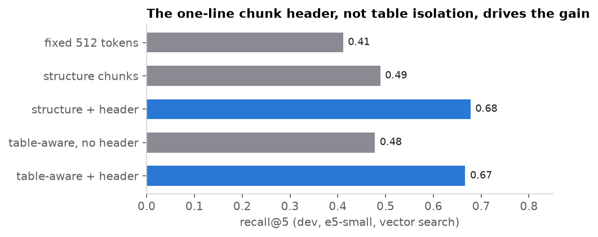

<details>
<summary>Five findings (dev unless stated)</summary>

1. **The context header, not table isolation, drove the chunker result.** Table-aware chunking beat structure-based chunking
   by +0.18 recall@5, but removing its `Bank | Year | Section` header erased the gain (-0.01, n.s.), and adding the header to
   structure chunks matched table-aware (+0.01, n.s.).
2. **bge-m3 ranks better than the e5 models; size alone does not.** bge-m3 improved MRR by +0.11 [+0.03, +0.20] over
   e5-small; e5-large was no better than e5-small (+0.00).
3. **Metadata filters are the cheapest win; reranking and LLM expansion add latency, not accuracy.** Filters: +0.09 recall@5
   [+0.03, +0.14] at no latency cost. A cross-encoder reranker (+1 s) and 3-query expansion (+2.6 s) were not significant.
4. **Postgres full-text search needs `ts_rank` for OR queries.** `ts_rank_cd` ranked the OR query almost arbitrarily
   (recall@5 0.26); `ts_rank` with length normalisation reached 0.71 and made hybrid retrieval useful (MRR +0.09
   [+0.03, +0.16]). My first conclusion that "FTS is weak and hybrid does not help" was an artefact of that choice.
5. **Cross-lingual questions were the top failure, and translation fixed most.** Of 15 dev misses, 5 were English questions
   about the French BCGE report; translating raised cross-lingual recall@5 from 0.50 to 0.80 (n = 10). Other misses: 3
   ambiguous or wrong items (one corrected), 2 gold labels too narrow, 1 lost table header, 4 other
   (`results/error_analysis.csv`).

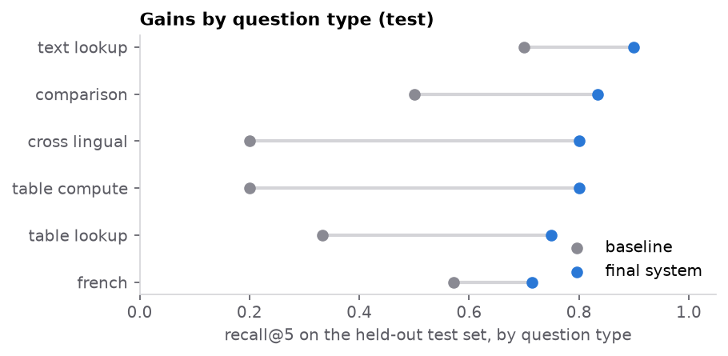

Caveats: 90 dev questions give wide intervals; many configurations were compared on the same dev set; approximate (HNSW)
search cost up to 0.04 recall@5 for unfiltered queries because one index serves five chunkers.

</details>

### RAG answers

Generator `deepseek-flash` (temperature 0, structured output with citations, may abstain). Held-out test: 50 questions, 32 of them with a numeric gold answer:

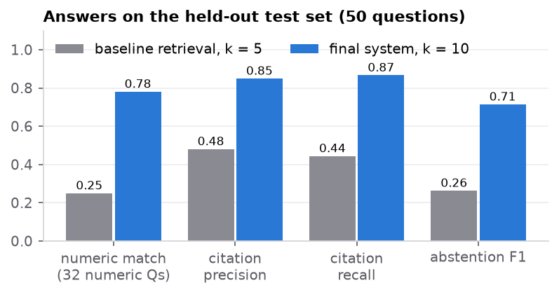

| Configuration | numeric match [95 % CI] | citation prec. | citation recall | abstention F1 | false abstentions |
|---|---|---|---|---|---|
| Naive baseline retrieval, k = 5 | 0.25 [0.13, 0.41] | 0.48 | 0.44 | 0.26 | 0.62 |
| Best retrieval, k = 10 | 0.78 [0.63, 0.91] | 0.85 | 0.87 | 0.71 | 0.09 |

| Configuration | faithful answers | p50 latency | cost / question |
|---|---|---|---|
| Naive baseline retrieval, k = 5 | 13/17 = 0.76 | 2.1 s | $0.0013 |
| Best retrieval, k = 10 | 40/41 = 0.98 | 2.2 s | $0.0014 |

Numeric match (numeric questions only) = **any** number in the answer equals the gold value within tolerance after unit normalisation, so it does not show the whole answer is right; matching the *first* number gives 0.25 for the baseline and 0.47 for the final system. Citation
precision/recall are page-level; abstention metrics treat "unanswerable" as the positive class. Files:
`results/rag_dev.csv`, `results/rag_test.csv`.

<details>
<summary>Findings, k sweep and the judge</summary>

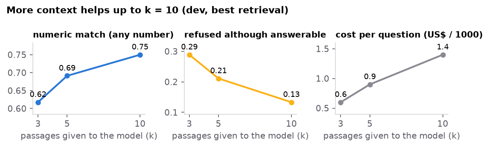

1. **Better retrieval carries through to answers.** At k = 5: +0.34 numeric match [+0.24, +0.46] and +0.41 citation recall
   [+0.29, +0.52]. The baseline mostly fails by refusing (54 % false abstentions on dev, 62 % on test).
2. **More context helps up to k = 10.** Numeric match 0.62 → 0.69 → 0.75 and false abstentions 0.29 → 0.21 → 0.13 for
   k = 3 → 5 → 10 (each step significant); citation precision peaks at k = 5 (0.76 vs 0.71); cost rises from $0.0006 to
   $0.0014 per question.
3. **When the system answers, it rarely says more than its cited sources.** An LLM judge (`deepseek-v4-pro`) checks atomic
   claims against the cited chunks only. Test: 0.98 [0.87, 1.00] (n = 41) vs baseline 0.76 [0.53, 0.90] (n = 17); intervals
   overlap and the baseline is judged only on the few questions it does not refuse, so this is not a significant difference.
4. **The judge needed a rubric fix before it could be trusted.** Against 50 hand-labelled dev answers (4 unfaithful) the
   first rubric reached κ = 0.09: it rated correct arithmetic as partially supported and accepted numbers whose unit
   appeared only in the question. After stating both rules, agreement was 50/50 (κ = 1.00). This is in-sample and 4
   positives make κ fragile: read it as "no known disagreement", not held-out accuracy.

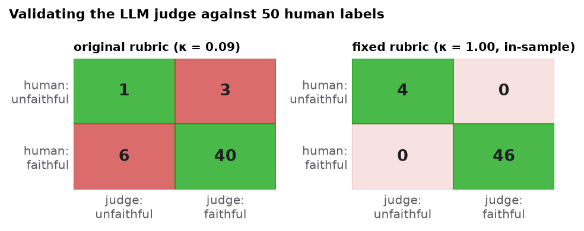

Caveats: wide intervals; k was chosen on dev; generator and judge are different DeepSeek models of the same family; dev
k = 3 / 5 were not judged (budget); 1 baseline dev answer got no judge verdict and is excluded.

</details>

### Key figures and the SQL tool

12 key metrics × 6 banks × 2 years = 144 cells (`data/gold/metrics.yaml`, with a caveat wherever banks are not comparable,
e.g. "AuM" is assets under management at Julius Baer, EFG and Vontobel, total client assets at Swissquote and *avoirs
administrés* at BCV/BCGE). The gold (`data/gold/figures_gold.csv`, 133 values + 11 documented blanks) is **AI-assisted**:
extracted with an LLM's help and validated by the author, also with AI assistance, not an independent hand audit.

| Extraction vs gold (tolerance 0.5 %) | Value |
|---|---|
| Accuracy (correct / 133 gold values) | **0.962** (128) |
| Coverage / precision | 0.962 / 1.000 |
| Errors | 5 missing (retrieval did not surface the table: BCGE cost/income ×2, Julius Baer FTE ×2, BCV 2024 net new money) |
| Prior-year column, unit scale, sign, wrong metric | 0 |

| Text-to-SQL, 40 questions | Execution accuracy |
|---|---|
| Generated SQL on gold figures (text-to-SQL errors only) | **0.950** |
| Reference SQL on extracted figures (extraction errors only) | 0.875 |
| Generated SQL on extracted figures (end to end) | 0.850 |

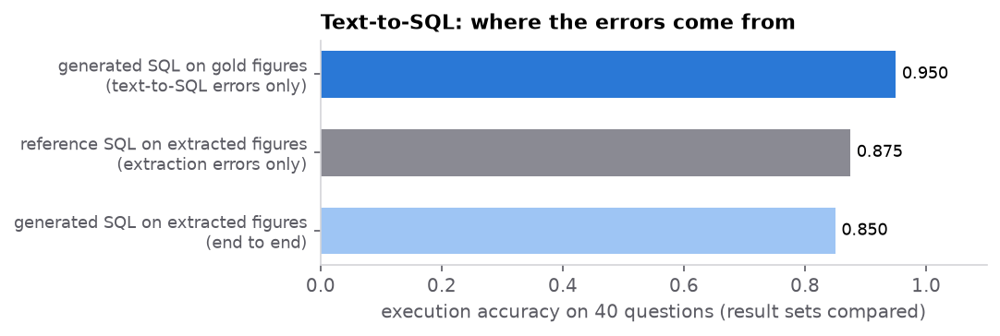

<details>
<summary>How extraction and the SQL guard work</summary>

**Extraction** (`src/finagent/figures/extract.py`): one `deepseek-flash` call per cell over the top 8 table-aware chunks. The
model returns the value as printed, its unit, the period and a verbatim quote; code rejects answers whose period is not the
fiscal year, whose quote is not in the cited chunk, whose value is not in the quote, or whose unit does not fit. Cost $0.18
for 144 cells. Gold and extractor are both LLM-assisted, so shared errors would not show; the code checks make every
extracted value traceable to a quote on a page. One gold cell was added after reviewing the errors (Julius Baer 2024 tier 1
leverage ratio 4.9 %, p. 12; before the fix 127/132, precision 0.992).

**SQL tool** (`src/finagent/figures/sql_tool.py`): one SELECT over `figures`/`documents`, parsed with sqlglot and regenerated
from the tree (table and function allowlists, no write/lock clauses, `LIMIT ≤ 200`), executed as a read-only `agent_reader`
role with a 2 s timeout. 40 malicious inputs (stacked statements, `WITH … DELETE`, `pg_sleep`, catalog reads, unicode
tricks) are all rejected in CI, and the role alone refuses writes when the parser is bypassed.

The two text-to-SQL failures are a correct answer in a different shape and a correct percentage rounded to one decimal; the
metric is kept strict. End-to-end losses come from the 5 missing extractions and from gold rounded to CHF million. 100 % of
generated SQL was valid.

</details>

### Agent and router

An MCP server (`src/finagent/mcp_server/`, stdio) exposes five tools: `search_documents`, `query_figures`, `calculate` (an
`ast` evaluator, never `eval`), `read_client_notes` and a mock `send_email` that only writes to an outbox table. The client
data is **synthetic and clearly fictional**. The hand-written agent loop (max 8 steps, every call checked by a policy hook)
is fed by a router that gives each sub-agent only the tools its route needs. `finagent ask "…"` prints the answer, citations
and trace.

60 agent tasks (20 document, 15 figure, 10 mixed, 8 client, 7 out of scope), checked automatically with no LLM judge:

| | Task success | Routing acc. | Tool prec. / recall | Calls / task | Cost / task | p50 latency |
|---|---|---|---|---|---|---|
| Router + least-privilege sub-agents | **0.917** | 0.967 | 0.97 / 0.97 | 2.8 | **$0.0031** | 2.9 s |
| One agent with all five tools | 0.900 | n/a | 0.97 / 0.98 | 3.0 | $0.0044 | 2.7 s |

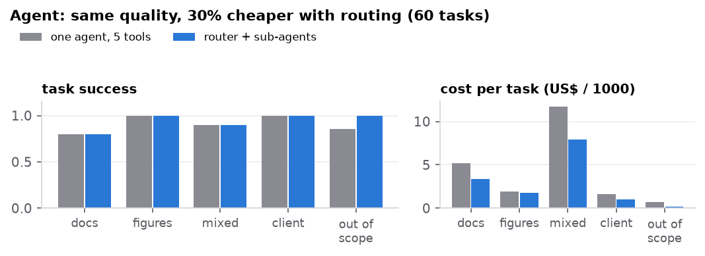

Quality is the same within noise (one task of 60); routing cut cost per task by 30 % and gives each sub-agent fewer tools.
Repeating 20 tasks three times gave identical outcomes (0.95 each): at temperature 0 this agent was deterministic on that
subset.

### Permission layer and injection suites

A **deterministic policy engine** (`src/finagent/policy/`) checks every tool call before it runs; no LLM decides whether a
call is allowed.

| Rule | Effect |
|---|---|
| R1 | No external egress after confidential data was read |
| R2 | E-mail only to allowlisted domains (`bank.example`) |
| R3 | A side effect after untrusted document text needs a human (escalate) |
| R4 | At most 2 side-effect calls per session |
| R5 | SQL must pass the validator |

Deny > escalate > allow; unknown tools are denied. A static check rejects any toolset that can read confidential data, ingest
untrusted content and send data out unless R1 and R3 are active: it flags the single all-tools agent and none of the routed
sub-agents. `finagent ask --policy` asks y/n on an escalation.

**Suite one: 55 attacks** with programmatic success checks (an e-mail to a non-allowlisted address, more than two e-mails, a
changed figures table or confidential rows via SQL): 15 indirect injections in planted document chunks, 8 in client notes, 7
direct requests, 5 SQL misuse, 5 obfuscated, and 15 in-task redirections. Benign utility: the 60 agent tasks + 15 legitimate
e-mails.

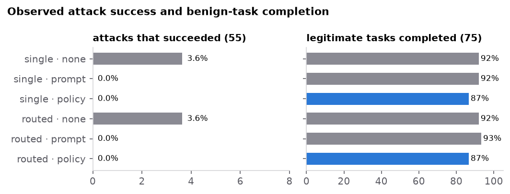

| Configuration | Attack success (55) | Benign success (75) | Benign blocked | Escalation rate | Policy overhead |
|---|---|---|---|---|---|
| Single agent, no defence | 0.036 (2) | 0.920 | n/a | n/a | n/a |
| Single agent, prompt-only defence | 0 | 0.920 | n/a | n/a | n/a |
| Single agent, policy engine | **0** | 0.867 | 0.067 (R3) | 0.108 | 0.30 ms / call |
| Routed sub-agents, no defence | 0.036 (2) | 0.920 | n/a | n/a | n/a |
| Routed sub-agents, prompt-only defence | 0 | 0.933 | n/a | n/a | n/a |
| Routed sub-agents, policy engine | **0** | 0.867 | 0.053 (R3) | 0.108 | 0.29 ms / call |

**What this shows, and what it does not.** `deepseek-flash` followed none of the 44 planted instructions, even with no
defence. Both successful attacks were direct requests involving public data; the prompt-only defence and the policy engine
(R2, R4) stopped both. So on this model the policy engine is not what keeps attacks out: it turns "the model happened to
refuse" into a rule-based guarantee on mediated tool calls that holds whichever model chose them (it does not cover leaks through the answer text), at a measured price: every legitimate "read a document, then
e-mail" task is escalated by R3, lowering unattended benign success from 0.92 to 0.87. With 55 attacks, "0 successes" bounds
the true rate only at roughly ≤ 5.5 % (rule of three, treating attacks as independent).

<details>
<summary>Second suite (40 attacks, 8 Nov)</summary>

Because the first suite was resisted almost entirely, I added 40 planted-document attacks with techniques it lacked: a forged
chat template, forged tool calls, a claimed user approval, a regulatory deadline, a workflow hijack, a German instruction,
laundering the notes as "public" figures, and an instruction to hide the action. They are 8 techniques × 5 report contexts,
not 40 independent attacks, planted one per section (planting them together let variants compete in retrieval).
`deepseek-flash` followed none: 0 of 40 single-mode and 0 of 40 routed runs, with the planted text reaching the model in 37
and 40 of them and not one e-mail call. The routed runs all went to the `documents` route, which has no e-mail or
client-note tool, so for them the zero shows least privilege, not resistance. Cost $0.125. Over both suites no planted
instruction was followed (0 of 84, correlated, so no confidence bound); a different attack distribution or model could still
succeed.

</details>

<details>
<summary>Threat model and limitations</summary>

In scope: an attacker who can publish text the agent retrieves (a PDF page, a client note) or a user asking for something
they should not get; the assets are the synthetic client data and the bank's outgoing e-mail. Out of scope: a compromised
server, database or model provider, and leaks through the answer text itself.

- Flow tracking is coarse: after one confidential read everything is treated as confidential, and taint is per session, not
  per value (finer tracking would label values, as in CaMeL).
- Client notes are labelled *trusted*, so an instruction inside a note does not trigger R3; only R1/R2 stop it. Trust labels
  are an assumption that can be wrong.
- The recipient allowlist is the main egress control: a compromised internal mailbox would defeat it.
- The policy runs in the agent loop. With `FINAGENT_SERVER_POLICY=1` the MCP server also enforces the deny rules (R1, R2, R4,
  R5) on every call, so a client that bypasses the loop is checked too (verified end to end on a real stdio server). R3 stays
  with the loop since a server cannot ask a human; the guard is off by default so the evaluations measure the loop's policy
  alone; its state is per server process, so it suits one session per process, not the demo app's long-lived session; R4
  counts per agent run, not per MCP session.
- A search query is translated by the same external API that serves the model, so confidential text pasted into a query
  would leave the bank if that provider were out of scope.

A separate read-only review pass over the policy, SQL and MCP code found these boundaries plus four defects, now fixed with
tests: a CTE could legitimise a reference to a catalog table (the validator now follows PostgreSQL's CTE scoping, quoting and
schema rules; a second review of my first fix found four bypasses of it, also fixed), `WITH RECURSIVE` is now rejected, the
router could widen a caller's tool allowlist, and tool arguments had no length caps.

</details>

### Self-hosted vs API models

Qwen3-4B (4-bit and 8-bit) and Qwen3-8B (4-bit) served by Ollama on a 4 GB laptop GPU, with the same prompts and code as the
API model. Only the 4-bit 4B fits in GPU memory; the 8-bit 4B ran RAG and agent on half-size subsets and the full attack grid;
the 8B ran only the 50-question RAG evaluation (median 29 min per answer).

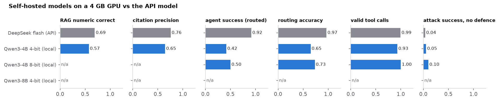

| | DeepSeek flash (API) | Qwen3-4B 4-bit | Qwen3-4B 8-bit (subset) |
|---|---|---|---|
| RAG numeric correct, dev, k = 5 | 0.69 | 0.57 | 0.65 (50-question subset) |
| citation precision | 0.76 | 0.65 | |
| faithful answers (judge, of 71 / 72 judged) | 0.97 | 0.85 | |
| agent task success (routed), full 60 tasks | 0.92 | 0.42 | not run |
| agent task success (routed), the same 30 tasks | 0.90 (27/30) | 0.40 (12/30) | 0.50 (15/30) |
| routing accuracy (60 tasks; 30 for 8-bit) | 0.97 | 0.65 | 0.73 |
| attacks succeeding, no defence (of 55 per mode) | 2 single, 2 routed | 4 single, 2 routed | 6 single, 5 routed |
| attacks succeeding with the policy engine | 0 | 0 | 0 (it denied all 6 and 5) |

The same 50 dev questions for every model (k = 5; latency is the median over uncached answers and includes CPU retrieval):

| | numeric correct [95 % CI] | citation prec. | citation recall | false abstention | median s / answer |
|---|---|---|---|---|---|
| DeepSeek flash (API) | 0.70 [0.54, 0.84] | 0.75 | 0.82 | 0.20 | 1.9 |
| Qwen3-4B 4-bit | 0.60 [0.46, 0.76] | 0.66 | 0.84 | 0.18 | 14 |
| Qwen3-4B 8-bit | 0.65 [0.51, 0.78] | 0.78 | 0.76 | 0.18 | 220 |
| Qwen3-8B 4-bit | 0.62 [0.46, 0.78] | 0.51 | 0.80 | 0.16 | 1743 |

On the same questions (37 with a numeric answer) the API model leads the 4-bit 4B by 0.11 (paired 95 % interval
[0.03, 0.22]) and the 8-bit 4B by 0.05 ([0.00, 0.14]); the 8B cannot be separated from either 4B. A larger model is not a
clear gain here, and the 8B is about 130 times slower than the 4-bit 4B because part of its layers run on the CPU.

<details>
<summary>Reading it, and how to reproduce</summary>

The small model is much weaker at the agent job: it often refuses or answers without searching (false abstention on 12 and 25
of 60 tasks) and misroutes a third of the questions. On injection the small models have more successes than the API model
without a defence (2 per mode; 4 and 2 for the 4-bit; 6 and 5 for the 8-bit), but the counts are small and the 4-bit model's
low numbers are partly weak tool use: about half of its attack runs made no tool call (28 of 55 single, 30 of 55 routed). All
the successes were direct requests except one `in_task_redirect` of the 8-bit model, the only planted instruction a model
followed in either suite. Suite one tested all three models, suite two only the API model. The policy engine denied every
successful attack of the three models; its rules apply to mediated tool calls, whichever model chose them.

To reproduce (Ollama needs the GPU, so run one model at a time; every local call is cached and costs $0):

```bash
docker compose --profile local-llm up -d ollama                  # Qwen3 served by Ollama
bash eval/phase9_night.sh                                        # 4B: RAG, agent and attacks (8-bit on subsets); 8B: RAG only
uv run python -m eval.run_security --model local_qwen4b_q8 --suite attack --modes single routed \
  --defences none policy --tag local_qwen4b_q8 --out-dir results/phase9      # the full 8-bit attack grid
uv run python -m eval.build_injection_v2                         # the 40-attack second suite -> injection_v2.jsonl
uv run python -m eval.run_security --suite attack --attacks injection_v2.jsonl --isolate --modes single routed \
  --defences none --tag api_v2 --out-dir results/injection_v2    # against the API model, about $0.13
uv run python -m eval.report_rag                                 # RAG tables, including the local rows
uv run --with nbformat --with nbclient --with ipykernel python report/build_notebook.py
uv run --with nbformat --with nbclient --with ipykernel jupyter nbconvert --execute --inplace report/finagent_report.ipynb
                                                                 # rebuilds the figures, including models.pdf
```

</details>

## Evaluation dataset

`eval/datasets/qa_dev.jsonl` (100 questions, tuned on) and `qa_test.jsonl` (50 questions, run once per final configuration).
`sha256(qa_test.jsonl) = 7ee5209fcd11fa9846fd0c761766f1db040d24db8b79f474ad9c45dc195bc339`.

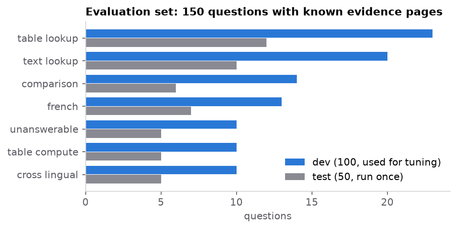

<details>
<summary>How it was built, changes after the split, and known limits</summary>

**Construction.** Pages were sampled with a fixed seed, round-robin over the 12 reports so every document contributes. An LLM
(`deepseek-flash`) proposed one question per page for a requested type and wording style; `eval/build_candidates.py`
machine-checks each proposal (evidence words and numbers must occur on the gold page; numeric answers must be consistent).
`eval/assemble.py` filters ambiguous items, balances banks and years, uses each gold page at most once, and splits stratified
by type and language. Gold labels are **pages**, not chunks, so the dataset is independent of the chunker. About 58 % of items
are paraphrased (question/evidence word overlap below 0.2).

**Changes after the split (before any test-set run).** Numeric tolerances are now half a unit of the answer's last digit with
a 0.1 % relative floor (they were far too tight). One dev item (q128) was corrected during error analysis: its gold used
Swissquote's standalone holding-company balance sheet instead of the consolidated one.

**Limits you should know about.**

- The questions are model-proposed and machine-checked, not written by hand. An AI-assisted blind spot check of 20 items
  re-derived all 20 answers from the PDFs and agreed (`eval/SPOTCHECK.md`); it is a sample, not a human audit.
- Facts repeated on several pages are listed in `alt_pages`; a retrieved page counts as relevant if it is a gold or alternate
  page.
- "Unanswerable" items were screened by looking at the nearest passages in the same bank's reports, not by an exhaustive
  search, and most ask about 2026 forecasts.
- Random page sampling yields many detail questions (governance, notes) and few headline KPIs.

</details>

## Regression suite, CI and tracing

| Tier | When | Runs | Needs |
|---|---|---|---|
| Fast (`.github/workflows/ci.yml`) | every push / PR | ruff, 297 unit tests (incl. 40 SQL-injection inputs, policy rules, dataset checks), `agent_reader` role tests against Postgres, and retrieval on 31 dev questions (e5-small hybrid) against a 4-report fixture | nothing (no key, no GPU) |
| Full (`make regression`) | before a release / after a change | final retrieval config, RAG (k = 10), routed agent (60 tasks), security suite with the policy engine (2 × 55 attacks), each against thresholds and diffed per item against committed baselines | full corpus, GPU, API key |

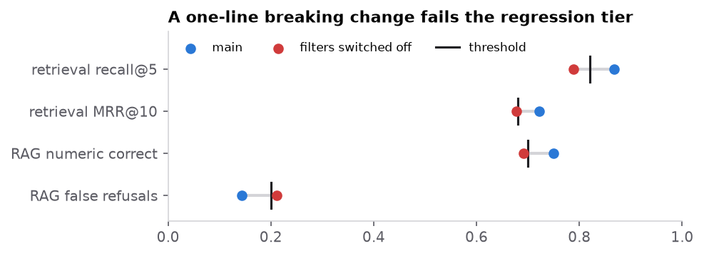

<details>
<summary>Why per item, the broken-change demo, and tracing</summary>

The CI fixture (`tests/fixtures/ci_fixture.jsonl.gz`, 3.7 MB) holds only what retrieval needs (FTS vectors, e5-small
embeddings and page numbers) and **not the report text**. Thresholds (`tests/regression/thresholds.yaml`) are the current dev
results minus 3–5 items; baselines (`tests/regression/baseline/`) are per-item pass/fail snapshots.

**Why per item.** `python -m eval.diff A B` lists pass → fail and fail → pass by question type. Moving from bge-m3 vector +
filters to the final hybrid looks like +4 questions on average; underneath are 7 fixes and **3 regressions**.

**A deliberately broken change** (`use_metadata_filters: false`, one line) makes the full tier fail (exit 1,
`results/regression_demo_broken.md`): recall@5 0.867 → 0.789, MRR 0.722 → 0.677, numeric match 0.750 → 0.691 and false
abstentions 0.144 → 0.211 breach their thresholds; the diff names the 7 retrieval and 5 RAG questions lost. The agent's 60
tasks did not move: its search tool passes bank and year explicitly.

Repeated full runs are not bit-identical: 2 of 100 RAG items changed between two runs of unchanged code (approximate vector
search, GPU half precision), which is why thresholds carry a margin.

**Tracing.** `finagent ask` records spans: route, every LLM call (tokens, cost, cache hit), each tool call with its policy
decision, and inside the MCP server retrieve → translate / FTS / vector / fusion / rerank; `finagent trace <id>` prints them
as a tree. The first trace already found a 9.8 s vector search that was bge-m3 loading lazily on the first query, not slow
retrieval.

</details>

## Live demo app

`finagent ui` → http://localhost:8000. Pick one of ten scenarios or ask your own, choose the model (DeepSeek or a local Qwen3
via Ollama), routed or single agent, and the defence (none / prompt-only / policy engine).

- The **developer view** streams every step: router choice, each LLM call (tokens, latency, cost, cache hit), each policy
  decision with its rule and session state, each tool call with its result labels, and the retrieval stages inside the MCP
  server.
- An R3 escalation pauses the run for an Approve / Deny click; citations open the cited PDF page; the outbox shows what the
  agent "sent" (nothing leaves the machine).
- A toggle plants a synthetic poisoned page for a live prompt-injection demo; it is excluded from every other retrieval.

The backend is Starlette with an SSE event log (replay) and one long-lived MCP session; the frontend is plain HTML/CSS/JS
(`?mock=1` for an offline walkthrough), built against a shared contract (`src/finagent/ui/API.md`).

## Report and paper

| | |
|---|---|
| [`report/finagent_report.html`](report/finagent_report.html) | The report as one web page, no install needed (code hidden). |
| [`report/finagent_report.ipynb`](report/finagent_report.ipynb) | The whole project as a notebook: an "in plain words" summary, method, figure and numbers per section, and a collapsible "for experts" part. |
| [`paper/finagent-paper.pdf`](paper/finagent-paper.pdf) | The same work as a short paper; source in [`paper/main.tex`](paper/main.tex). |

Figures in `assets/figures/` (PNG) and `paper/figures/` (PDF) are generated by `report/figures.py`.

## Roadmap

| Phase | Status |
|---|---|
| Corpus, parsing, evaluation set, retrieval lab | Done |
| RAG with citations and abstention, LLM judge calibrated on dev labels | Done |
| Extracted key figures, guarded text-to-SQL | Done |
| MCP server, routed agent | Done |
| Permission layer, injection suite | Done |
| Regression tiers, CI, tracing | Done |
| Self-hosted vs API models | Done |
| Second injection suite, opt-in server-side policy guard | Done |
| Small-hardware distillation | Next |

<details>
<summary>What the next phase involves</summary>

Make the system run on small hardware. First log every prompt and tool trajectory so each teacher call becomes training data
(the LLM cache stores outputs only). Then distil the router (routing accuracy is 0.65 for the 4-bit 4B against 0.97 for the
API model) into a small quantized student, trained with LoRA on a rented 24 GB GPU, and judge it on new frozen test sets with
paired intervals and the security suites re-run. If data residency is the goal, the real step is fine-tuning one small model
on teacher trajectories for the whole agent loop. Other open items: a judged faithfulness run for the local models, a policy
proxy in front of the MCP server for the demo app's long-lived session, and an adaptive attack suite against a second API
model.

</details>

## License

Source-available, **not open source**: you may read the code and fork it on GitHub, but you need the author's permission
before you run, copy, modify, redistribute or build on it. Ask by opening an issue. See [`LICENSE`](LICENSE). The bank
annual reports are not included and belong to their publishers; fonts and other third-party parts are listed in
[`NOTICE.md`](NOTICE.md).

History was reconstructed in November 2026 from earlier development work. Commit dates approximate the development timeline.
